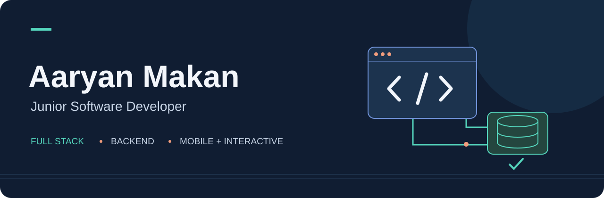
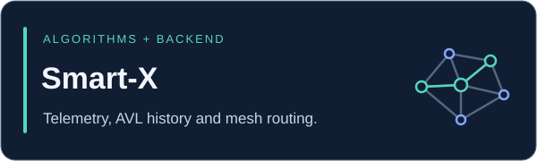
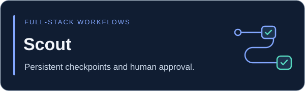
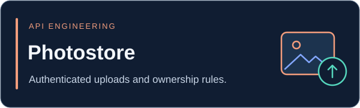
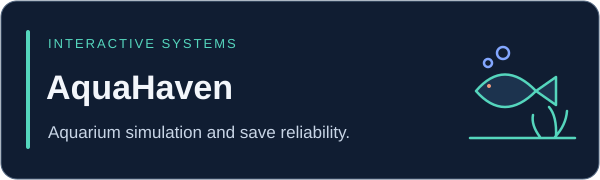
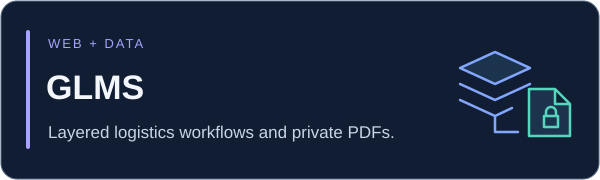
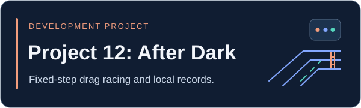
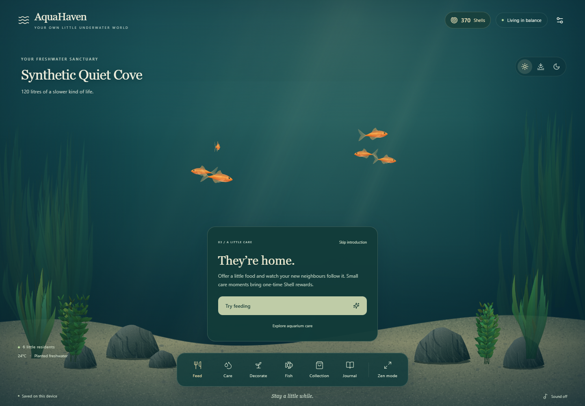

[Experience and skills](#experience-and-skills) · [Featured projects](#featured-projects) · [AquaHaven preview](#a-look-inside-aquahaven) · [Connect](#connect)

### Experience and skills

I'm **Aaryan Makan**, a Junior Software Developer at **IAT Fusion**. My portfolio includes personal development projects, university coursework, and collaborative prototypes.

I build web interfaces with **JavaScript, TypeScript, React and Next.js**, and APIs with **C#, ASP.NET Core, Node.js and Express**. I also have experience with **React Native, Firebase, SQL and MongoDB**. Across projects I work on integration, testing, debugging and interface design.

### Featured projects

| Project | Engineering focus | Context |
| --- | --- | --- |
| **[Smart-X](projects/smart-x-iot-console.md)** | Priority ingestion, graph routing and indexed history | University project with simulated IoT devices |
| **[ScriptSync Career Workspace](projects/scriptsync-career-workspace.md)** | Candidate evidence, application-specific answers and explicit approval | Prototype demonstrated with synthetic data |
| **[Photostore](projects/photostore-api.md)** | Authentication, image validation and storage failure handling | University API project |
| **[AquaHaven](projects/aquahaven.md)** | Stateful simulation, persistence and recovery | Personal development preview |
| **[GLMS](projects/glms-logistics-platform.md)** | MVC/API separation, service rules and private PDF downloads | University project with hosting controls in development |
| **[Project 12: After Dark](projects/project-12-after-dark.md)** | Fixed-step drag racing, vehicle controls and local race records | Personal development project |

These cards open project overviews. Complete implementations remain private.

### Collaborative projects

I contributed to two team projects. **[Campus Crisis Agent](projects/campus-crisis-agent.md)** groups fictional incident reports and replays decisions. **[HustleHub+](projects/hustlehub-plus.md)** is a service marketplace prototype with role-based flows and booking checks. Individual contribution details are still under review.

### A look inside AquaHaven

AquaHaven **1.4.0-alpha.1**, a local development preview running with a synthetic aquarium save. Progress is stored in the browser; cloud sync is not included. [Explore the design](projects/aquahaven.md).

### Connect

[Personal GitHub · @aaryanmakan2003](https://github.com/aaryanmakan2003)

### Rights and reuse

Copyright (c) 2026 Aaryan Makan. All Rights Reserved for independently owned original work, subject to [the scope and exceptions in this notice](COPYRIGHT.md). [Third-party asset notices](ASSET_NOTICES.md).
