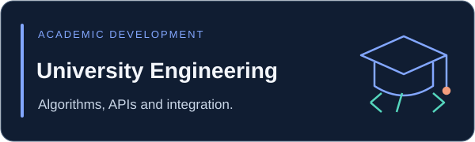
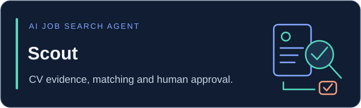

[Experience and skills](#experience-and-skills) · [Featured projects](#featured-projects) · [University experience](#university-and-hackathon-experience) · [AquaHaven preview](#a-look-inside-aquahaven) · [Connect](#connect)

### Experience and skills

I'm **Aaryan Makan**, a Junior Software Developer at **IAT Fusion**. My portfolio includes personal development projects, university coursework, and collaborative prototypes.

I build web interfaces with **JavaScript, TypeScript, React and Next.js**, and APIs with **C#, ASP.NET Core, Node.js and Express**. I also have experience with **React Native, Firebase, SQL and MongoDB**. Across projects I work on integration, testing, debugging and interface design.

### Featured projects

**[Smart-X](projects/smart-x-iot-console.md)** — telemetry algorithms and resilient mesh routing.

**[University Engineering](projects/university-engineering.md)** — connecting algorithms, data, APIs and collaborative development across coursework.

**[Photostore](projects/photostore-api.md)** — authenticated photo workflows with validation and storage recovery.

**[AquaHaven](projects/aquahaven.md)** — a procedural aquarium exploring simulation and dependable local saves.

**[GLMS](projects/glms-logistics-platform.md)** — layered logistics workflows and controlled document access.

**[Project 12: After Dark](projects/project-12-after-dark.md)** — a personal development project exploring fixed-step drag racing.

**[Scout — AI Job Search Agent](projects/scriptsync-career-workspace.md)** — CV-aware matching, persistent application workflows and approval-controlled Demo ATS submission.

These cards open project overviews. Complete implementations remain private.

### University and hackathon experience

My university work connects algorithm design with the practical demands of APIs, databases and full-stack integration. I am especially interested in how a system behaves when requests overlap, storage fails or users need to recover their work. [Explore my academic engineering work](projects/university-engineering.md).

### Collaborative projects

I contributed to these team projects. **[Campus Crisis Agent](projects/campus-crisis-agent.md)** groups fictional incident reports and replays decisions. **[HustleHub+](projects/hustlehub-plus.md)** is a service marketplace prototype with role-based flows and booking checks. Individual contribution details are still under review.

### A look inside AquaHaven

AquaHaven **1.4.0-alpha.1**, a local development preview running with a synthetic aquarium save. Progress is stored in the browser; cloud sync is not included. [Explore the design](projects/aquahaven.md).

### Connect

[Personal GitHub · @aaryanmakan2003](https://github.com/aaryanmakan2003)

### Rights and reuse

Copyright (c) 2026 Aaryan Makan. All Rights Reserved for independently owned original work, subject to [the scope and exceptions in this notice](COPYRIGHT.md). [Third-party asset notices](ASSET_NOTICES.md).
