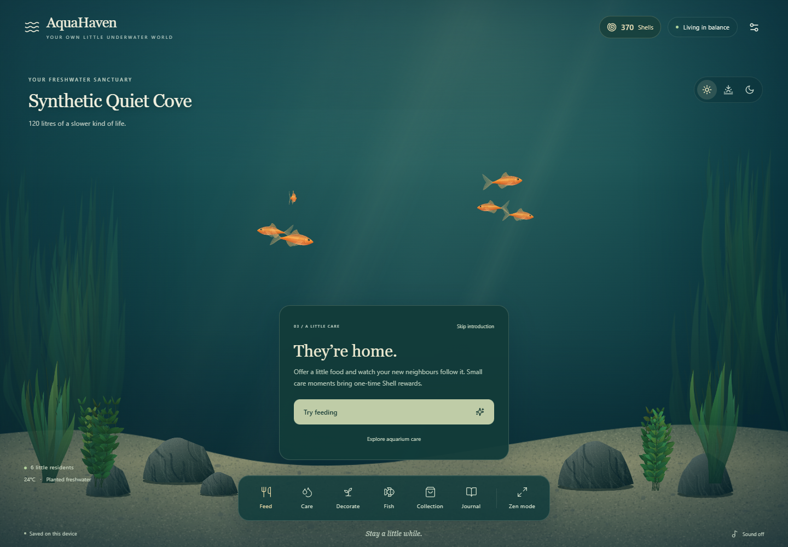
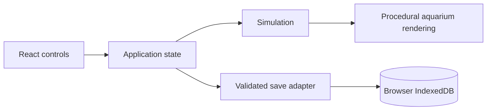

# AquaHaven

[Back to portfolio](../README.md)

A peaceful browser aquarium with original procedural artwork, gentle simulated care and recoverable local progress.

## Context and contribution

Personal development project. Version 1.4.0-alpha.1 is a development preview, not a claim of final creator acceptance.

## Engineering focus

- Four freshwater species with deterministic movement and original procedural textures.
- Collection purchases, care modes, food supplies and a simplified living ecosystem.
- Versioned saves, serialized writes, backup-preserving imports and explicit temporary sessions.

## Development status

Saves belong to one browser origin. There are no cloud accounts or cross-device sync. Simulation is fictional game logic, not aquarium-care advice. Physical-device coverage and subjective audio quality are not established by the automated checks.

Presentation only. The complete implementation remains private. No downloadable application or public source repository is claimed.

## Actual application preview

Actual local development capture; synthetic aquarium data. This is not a hosted demo.

## Architecture at a glance

Text alternative: controls update application state; simulation feeds the rendered aquarium, while a validated save adapter persists state in the browser. This is a high-level summary, with no implementation details or proprietary algorithms included.

[Copyright scope](../COPYRIGHT.md) · [Third-party notices](../ASSET_NOTICES.md)
